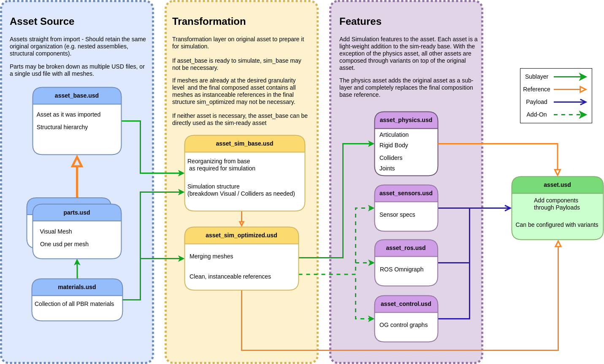

# Asset Structure
> **출처**: [Asset Structure](https://docs.isaacsim.omniverse.nvidia.com/5.1.0/robot_setup/asset_structure.html)  
  
Isaac Sim으로 가져온 asset들의 경우, 관리 / 재사용 / 시뮬레이션을 쉽게 하기 위해서 특정한 구조로 구성이 된다. 각 Asset들은 여러 구성 요소로 분리되며, 크게 다음과 같이 구분이 가능하다.


## Asset Source
이 단계의 Asset들은 **원래 파일 형식에서 Import 된 그대로의 원본 형태**를 나타낸다. 일반적으로 다음과 같이 구성이 된다.
1. **Base Asset (`asset_base.usd`)** : asset의 전체적인 구조 계층을 포함한다. 예를 들어서 robot assemblies 같은 전체적인 hierarchy가 들어간다.
2. **Parts(`parts.usd`)** : asset을 구성하는 개별 component들을 포함한다. 일반적으로 **mesh 하나당 USD 파일 하나**로 구성이 된다.
3. **Materials(`materials.usd`)** : asset에서 사용하는 **PBR(Physically Based Rendering) Material**들의 모음이다.

### Guidelines
- Soruce Asset은 변경하지 않아야 한다. 그래야 나중에 asset을 다시 import 하더라도 이후 단계에서 수행한 수정 사항을 잃지 않고 원본 asset을 자연스럽게 가져올 수 있기 때문이다.
- Hierarchy, Naming Convention, Part Assembly 같은 요소들은 전체 scene에 대해 일관성을 유지해야 한다.

## Transformation
이 단계에서는 asset을 실제 simulation에서 사용할 수 있도록 **구조를 재정리 하고 최적화**한다. Source asset에 다음과 같은 문제가 있는 경우 이 Transformation 과정이 필요하다.
- Nested Rigid Body가 존재하는 경우
- 시뮬레이션 요구사항에 적합하지 않은 복잡한 구조를 가진 경우

이 2가지 경우 시뮬레이션에 적합하게 만들기 위해서 구조를 Flatten해야 한다. Rigid Body들은 기본적으로 List 형태로 정리되어야 하며, Mesh의 전체 개수를 최소화 하도록 단순화 해야한다. Transformation 작업에는 이러한 것들이 포함이 된다.

1. **Reorganizing Structure** : 시뮬레이션에 필요한 구조를 생성한다. 예를 들어서 Visual과 Collider를 필요에 따라서 분리하며 시뮬레이션 요구사항에 맞도록 Hierarchy를 조정한다.
2. **Mesh 최적화** : 하나의 Rigid body로 동작할 mesh들은 서로 병합한다. Material의 개수를 단순화 하고 하나의 Visual Material List로 정리하며, mesh를 정리하고 성능 향상을 위해서 Instantiable Reference 형태로 구성한다.

## Features
이 단계에서는 시뮬레이션에 필요한 여러 기능들을 추가한다. 각 Feature는 변환 및 최적화 된 Asset 위에 추가되는 **별도의 가벼운 Layer**로 정의된다. 이런 Feature에는 다음과 같은 것들이 포함될 수 있다.
- Physics 설정
- Sensor 설정
- Control Graph
- 기타 Simulation 관련 기능

### Workflow for Adding and Modifying Features
일반적으로 Feature를 추가하거나 수정할 때는 다음 과정을 따른다.
1. 새로운 빈 Stage를 생성하거나 기존 Feature Stage를 연다.
2. 최적화 된 Asset인 `asset_sim_optimized.usd`를 **Sublayer**로 추가한다.
3. Root Layer를 수정하여 Feature를 추가하거나 변경한다.
4. 저장하기 전에 Stage Composition에서 최적화 Asset Sublayer를 제거하거나 비활성화 한다.
5. 해당 Feature를 최종 Asset에 **Payload**로 추가한다.
6. 필요하다면 Variant Set을 구성하여, 목록에서 선택하는 방식으로 여러 Featrue Set 사이를 빠르게 전환할 수 있도록 한다.

### Example Feature
- **Physics (`asset_physics.usd`)** : Rigid Body, Collider, Joint, Articulation 등을 추가
- **Sensors (`asset_sensors.usd`)** : Sensor의 Specification을 정의
- **Control Graphs (`asset_control.usd`)** : 시뮬레이션에 필요한 Control 관련 기능을 추가
- **ROS Integration (`asset_ros.usd`)** : ROS Omnigraph 관련 기능을 구성

> **Note**  
> Physics Feature는 예외적으로 처리된다. 해당 feature는 default prim에 **Reference** 형태로 추가되며, 다른 feature들의 경우 **Payload**로 추가된다. 또한 Physics Feature는 최적화 된 Asset에 대해 Layer Connection 형태를 유지한다.  
  
## Composition of Final Asset
최종적으로 합성된 asset은 `asset.usd` 파일로 표현되며, 시뮬레이션에 필요한 모든 component를 통합해서 구현된다. 세부적으로는 다음과 같다.
- **Sublayers**:
  - Base 혹은 최적화 된 asset을 Sublayer로 포함한다. 이 Layer는 Asset의 핵심적인 구조와 Visual 요소를 제공한다.
- **Payloads**:
  - Sensors나 Control Graph 같은 Feature들이 Payload 형태로 동적으로 추가된다. Payload를 활용하면 component들이 필요할 때만 유연하게 load할 수 있기 때문에 효율적인 구성과 모듈화가 가능하다.
- **References**:
  - Physics  설정은 Default Prim에 Reference 형태로 추가되어 일관적인 물리 연산 구성을 만들 수 있다.
- **Variants**:
  - Variant를 구성하면 asset을 복제하지 않더라도 서로 다른 Feature Set을 선택할 수 있다. 예를 들어서 서로 다른 Sensor 구성이나, 서로 다른 Control 구성 등이 있다.

이와 같은 모듈식 구조를 사용하면 최종 asset file을 가볍게 유지하면서도 높은 유연성을 확보할 수 있다. 따라서 다양한 시뮬레이션 시나리오에도 쉽게 대응 가능하다. 엔비디아측에서는 asset을 정리하기 쉽고 유지보수하기 좋은 상태로 유지하려면 위에 설명한 구조와 가이드라인을 따르는 것을 권장하고 있다.

## Folder 구조 권장 사항
asset들을 폴더 단위로 정리하는 것도 권장되며, 일반적으로 다음 구조를 사용하는 것이 좋다.
```
asset_root/
├── source/
│   ├── asset_base.usd
│   ├── parts.usd
│   └── materials.usd
│
├── features/
│   ├── asset_physics.usd
│   ├── asset_sensors.usd
│   ├── asset_control.usd
│   └── asset_ros.usd
│
├── asset_sim_optimized.usd
└── asset.usd
```
Isaac Sim의 Robot Importer들은 기본적으로 이러한 구조를 따른다.