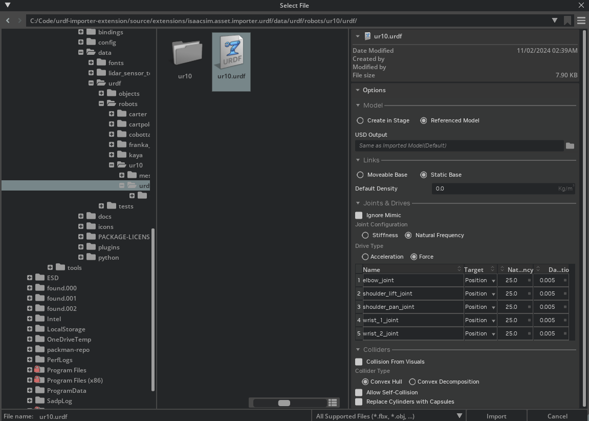

# URDF Importer Extension
> **출처**: [URDF Importer Extension](https://docs.isaacsim.omniverse.nvidia.com/5.1.0/importer_exporter/ext_isaacsim_asset_importer_urdf.html)  
  
**URDF Importer Extension**은 로봇의 URDF를 Isaac Sim으로 import 하기 위해서 사용한다. **URDF(Unified Robot Description Format)**은 ROS에서 로봇 모델을 표현하기 위해서 사용하는 **XML 기반 포맷**으로 가장 널리 사용되는 로봇 description 파일 중 하나로 봐도 무방하다.  
URDF 파일을 Import 하려면 상단 메뉴 바에서 `File > Import`를 선택하면 된다. 이 Extension은 기본적으로 활성화가 되어있으며, 만약 비활성화 되어있는 경우 Extension Manager에서 `isaacsim.asset.importer.urdf`를 검색해 다시 활성화 가능하다.

Import한 결과는 **Output.log**에 기록이 되며, 해당 로그에는 Import 과정에서 발생한 오류(error)나 경고(warning)이 표시된다. 더 자세한 로그 정보를 확인하고 싶다면 다음 방법을 사용하면 된다
- Isaac Sim의 Log File 열기
- Console을 Info Mode로 변경
- Isaac Sim을 --verbose Parameter와 함께 실행해서 Terminal Output에서 결과 확인

> **Note**  
> Import 된 모델들은 Isaac Sim Asset Structure Convention을 따른다. 또한 Mesh들은 성능 최적화를 위해서 이미 Isntantiable한 형태로 구성된다.  
  
## Conventions
> **Note!!**  
> USD Prim Naming Convention 준수를 위해, Link /  Joint / Mesh 이름 및 기타 Reference Asset Filename에서 특수 문자 사용은 지원되지 않는다. 지원되지 않는 특수문자는 `_`로 대체된다. 만약 이러한 변환으로 인해 이름이 `_`로 시작하게 된다면 이름 앞에 `a`가 추가된다. 이러한 이름 변경은 Import 이후가 아니라 URDF 원본 파일에서 직접 수행하는 것을 권장한다.

## Import Options
- **Model** : Model 항목에서는 다음 방식 중 하나를 선택할 수 있다.
  - Stage에 직접 Import
  - Reference Model 형태로 추가
  - 만약 **Create in Stage**를 선택한 경우 추가로 다음 옵션을 선택할 수 있다.
    - Import 된 Prim을 Default Prim으로 설정
    - Import 할 때 기존 Stage를 Clear
- **Links**
  - Robot base를 다음 2가지 중 하나로 설정할 수 있다.
    - **Moveable Base** : 예시로 Wheeled Robot이 있다.
      - Robot이 Moveable Base라면 Base Link가 움직일 수 있도록 설정된다.
    - **Static Base** : 예시로 6-dof Robot Arm이 있다.
      - Robot이 Static Base라면 Base Link가 `root_joint`를 통해 고정된다.
- **Default Density**
  - URDF에서 Mass가 지정되지 않은 Link에는 Default Density 값이 사용된다. Density를 0으로 설정하면 Physics Engine이 자체 Default Value를 이용해 Density를 자동 계산한다.

## Joints and Drives
각 Joint를 개별적으로 설정할 수 있는 Interface를 제공하며, 처음 열었을 때 Default Value들이 로드된다.
- **Ignore Mimic** : 이 옵션을 활성화 하면 URDF의 mimic tag를 import할 때 무시한다. 비활성화 되어있으면 mimic Tag가 있는 joint에 **PhysX mimic API**가 적용되어, 설정에 정의된 Primary Joint와 함께 동작할 수 있다.
- **Joint Configuration** : Joint 설정 방식 2가지 중 하나를 선택해서 진행할 수 있다 - Stiffness를 직접 설정 / Natural Frequency를 사용해서 설정